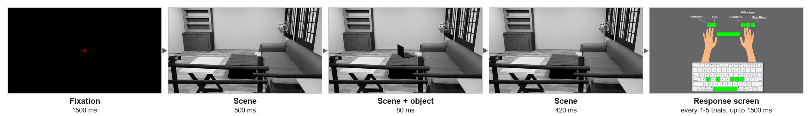

# Scene–Object EEG Task

A MATLAB / Psychtoolbox experiment for studying how scene context affects visual object recognition with EEG.

On each trial a target object is flashed for 80 ms inside a rendered indoor scene. The background is either the **intact scene** or a **scrambled** version of the same scene. After every 1–5 trials a response screen asks the participant which of five categories the last object belonged to. Event codes are sent to the EEG amplifier through a serial trigger box.



## Requirements

- MATLAB with [Psychtoolbox-3](http://psychtoolbox.org/)
- Image Processing Toolbox (`imresize`, `rgb2gray`)
- Statistics and Machine Learning Toolbox (`randsample`, `random`)
- A serial-port trigger box (57600 baud) connected to the EEG amplifier

The task was run on Linux with the trigger box on `/dev/ttyUSB0`. It uses MATLAB's `serial` interface, which is deprecated in recent MATLAB releases but still works.

## Running the task

1. Clone the repository and open MATLAB in its folder.
2. Set the trigger port in [`functions/experiment_parameters.m`](functions/experiment_parameters.m):
   ```matlab
   p.triggerPort = '/dev/ttyUSB0';  % e.g. 'COM3' on Windows
   ```
   To try the task without a trigger box, set `p.usetrigs = 0`.
3. Run the main script and enter the participant ID when asked:
   ```matlab
   Scene_Object_EEG_Task
   ```
4. The behavioural log is written to `results/<ID>_Behavioral_Scene_Object_<date_time>.csv`.

Use [`tools/test_trigger.m`](tools/test_trigger.m) to check the trigger box → amplifier link before a session.

## Repository layout

```
Scene_Object_EEG_Task.m      main experiment script
functions/                   parameters, display, response and trigger helpers
stimuli/
  images/<category>/level_1  stimuli used by the task
  images/<category>/level_2  second variation level (not used by default)
  instructions/              key-mapping screens
tools/test_trigger.m         trigger box check
results/                     behavioural logs (git-ignored)
docs/                        figures for this README
```

## Design

**Categories and objects** (5 objects per category):

| Category | Key | Objects |
|---|---|---|
| Food | F | Apple, BagOfChips, Banana, CanOfSoda, Watermelon |
| Electronics | S | Headset, Laptop, Microwave, Toaster, Vacuum |
| Container | J | Bowl, Jar, Kettle, Mug, ShoulderBag |
| Office supply | K | Folder, Marker, Pencil, Ruler, Stapler |
| Home decor | L | Mirror, Picture, Statue, Vase, WallClock |

**Conditions:** every object appears in an intact scene and in a scrambled scene. Images are shown in grayscale at 1024 × 576 px on a black screen.

**Runs:** 15 runs of 100 trials. Each run shows the 50 stimuli (25 objects × 2 backgrounds) twice, in a new random order per run. A run takes about 5 minutes and is followed by a break of at least 10 s.

**Trial:**

| Phase | Duration |
|---|---|
| Red fixation cross | 1500 ms |
| Scene without the object | 500 ms |
| Scene with the object | 80 ms |
| Scene without the object | 420 ms |
| Response screen (only on question trials) | up to 1500 ms |

A response screen follows after 1, 2, 3, 4 or 5 trials with probabilities 0.05, 0.15, 0.25, 0.30 and 0.25.

**Other keys on the response screen:** `P` pauses the task (press `C` to continue), `Q` quits.

### Stimulus files

Each object has five files in `stimuli/images/<category>/<level>/`:

| File | Content |
|---|---|
| `<Object>_Scene.png` | intact scene with the object |
| `<Object>_Scene_b.png` | intact scene without the object |
| `<Object>_Scramble.png` | scrambled scene with the object |
| `<Object>_Scramble_b.png` | scrambled scene without the object |
| `<Object>_S.png` | not used by the task |

The loader reads the files of each object in groups of five, so every level folder must contain exactly these 25 files.

## Trigger codes

| Code | Event |
|---|---|
| 55 | Start of the experiment |
| 30 | Start of a run |
| 35 | Fixation cross onset |
| 26 / 27 | Scene onset: intact / scrambled (level 1) |
| 28 / 29 | Scene onset: intact / scrambled (level 2) |
| 1–25 | Object onset; the code gives the object identity (below) |
| 59 | Response screen onset |
| 45 | Category key pressed |
| 60 | End of a trial without a response screen |
| 61 / 62 / 63 | End of a question trial: missed / wrong / correct |
| 50 | End of a run |
| 201 | Pause page |

Object codes: 1 Bowl, 2 Jar, 3 Kettle, 4 Mug, 5 ShoulderBag, 6 Headset, 7 Laptop, 8 Microwave, 9 Toaster, 10 Vacuum, 11 Apple, 12 BagOfChips, 13 Banana, 14 CanOfSoda, 15 Watermelon, 16 Mirror, 17 Picture, 18 Statue, 19 Vase, 20 WallClock, 21 Folder, 22 Marker, 23 Pencil, 24 Ruler, 25 Stapler.

## Output file

One row per trial:

| Column | Meaning |
|---|---|
| Trail Number | Trial within the run (1–100) |
| Run Number | 1–15 |
| Correctness | 1 correct, 0 wrong, −1 no answer, −2 no response screen on this trial |
| Category | 1 food, 2 electronics, 3 container, 4 office supply, 5 home decor |
| Cat_Answer | Category chosen (same coding); 0 no answer, −2 no response screen |
| Response Time (ms) | From the onset of the scene that follows the object (the response screen appears 420 ms later); 0 no answer, −2 no response screen |
| TrialOnSetTime | Seconds since the start of the first run |
| Level | Variation level (1) |
| WithOrWithout Scene | 1 intact scene, 2 scrambled scene |
| Image Name | File name of the stimulus set; the object is the text before the first `_` |

Each row ends with a trailing comma.
